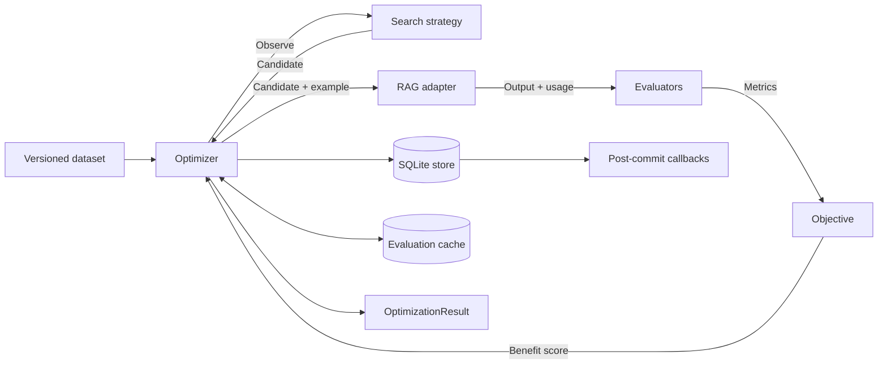
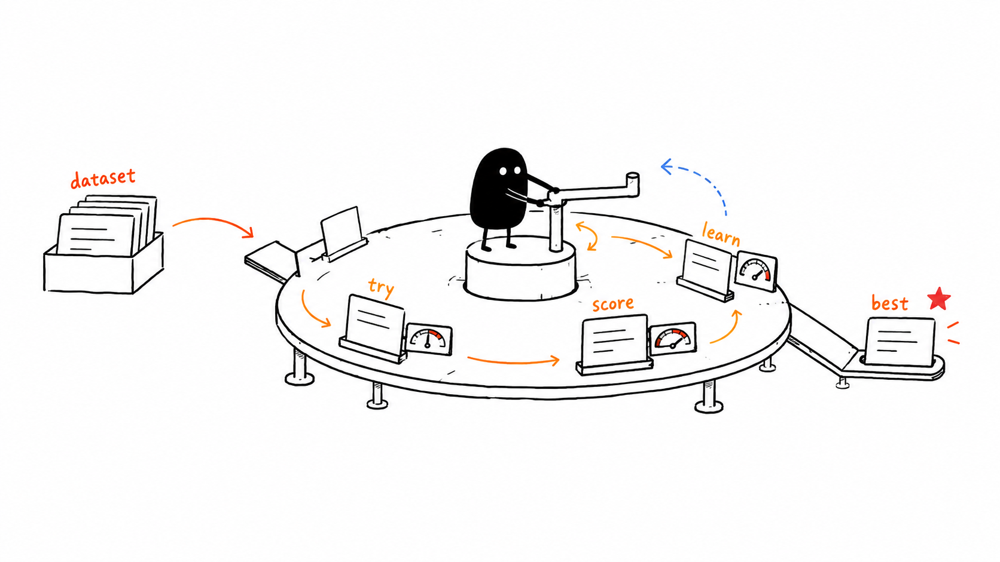
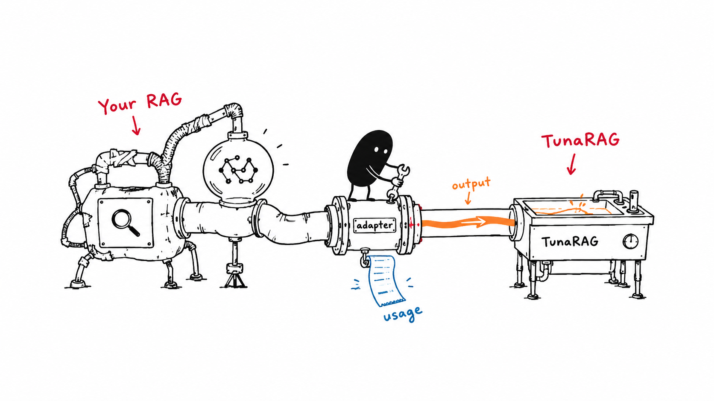
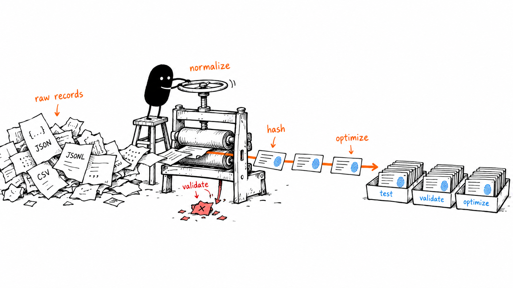
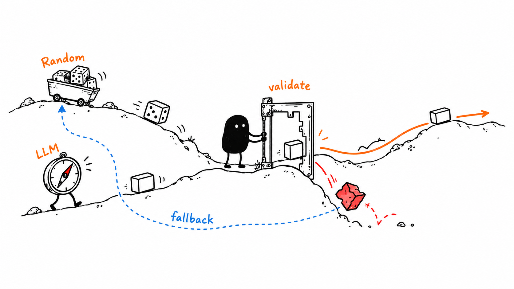
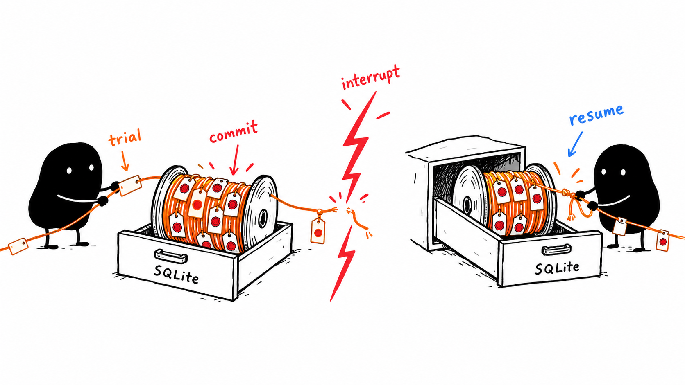
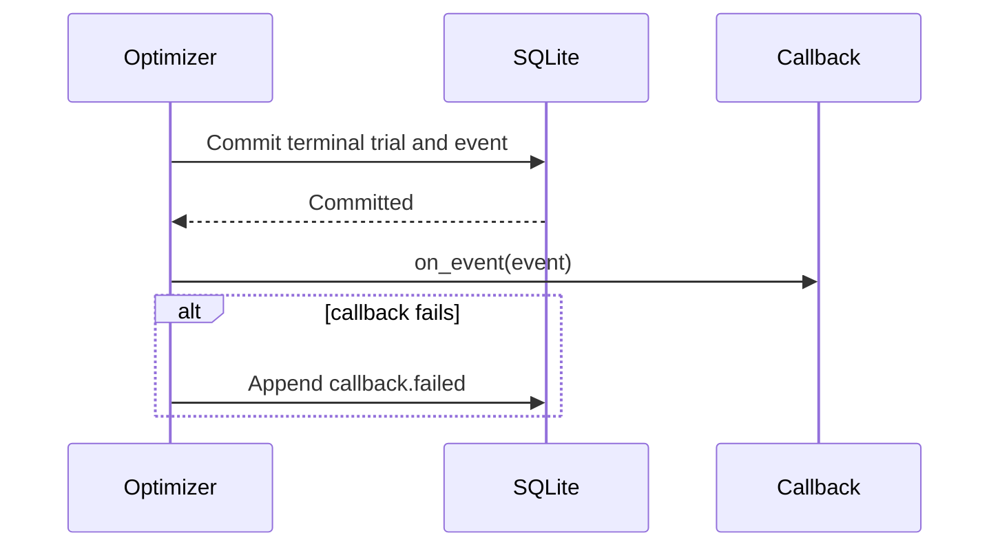
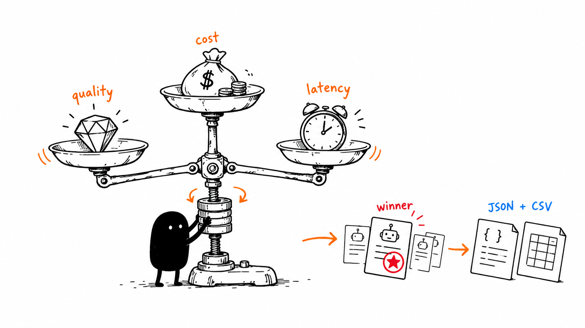

# TunaRAG Python

**Find the best configuration for your existing RAG application.**

TunaRAG is an open-source, Python-first optimization toolkit for retrieval-augmented generation
(RAG) systems. It connects to a RAG pipeline you already own, evaluates different configurations on
your data, and identifies the best tradeoff between **answer quality, cost, and latency**.

Instead of manually changing retrieval settings, prompts, or models and comparing a few examples by
eye, TunaRAG runs structured, repeatable optimization studies. It records every trial in SQLite,
isolates failures, supports resumable execution, and produces results you can inspect and export.

### What can you use it for?

- Find the best `top_k`, chunking, prompt, model, reranking, or generation settings for your RAG.
- Compare configurations with custom metrics or optional RAGAS evaluators.
- Optimize a weighted objective across quality, provider cost, and response latency.
- Search with deterministic random search or provider-neutral LLM-guided search.
- Tune LangChain, LangGraph, or Google ADK RAG pipelines without rebuilding them.
- Preserve reproducible experiments with caching, retries, callbacks, reports, and SQLite resume.

### Who is it for?

TunaRAG is designed for developers and AI teams that already have a working RAG pipeline and want a
reliable way to evaluate and improve it. Your application continues to own retrieval, generation,
indexes, provider clients, and credentials; TunaRAG owns the optimization workflow around it.

> Install the distribution as `tunarag-python` and import it as `tunarag`. Python 3.10-3.13 is
> supported.

**Documentation:** [shivamshinde123.github.io/tunarag-python](https://shivamshinde123.github.io/tunarag-python/)

## Comprehensive Usage Guide

The sections below explain every public TunaRAG Python V0.3 feature with executable examples.

## Contents

1. [Purpose and mental model](#purpose-and-mental-model)
2. [Installation](#installation)
3. [End-to-end quickstart](#end-to-end-quickstart)
4. [RAG adapters](#rag-adapters)
5. [LangChain integration](#langchain-integration)
6. [LangGraph integration](#langgraph-integration)
7. [Evaluation datasets](#evaluation-datasets)
8. [Synthetic QA generation](#synthetic-qa-generation)
9. [Search spaces and strategies](#search-spaces-and-strategies)
10. [Evaluators and RAGAS](#evaluators-and-ragas)
11. [Objectives](#objectives)
12. [Configuration](#configuration)
13. [Running optimization](#running-optimization)
14. [Stopping, retries, and concurrency](#stopping-retries-and-concurrency)
15. [Caching](#caching)
16. [SQLite persistence and resume](#sqlite-persistence-and-resume)
17. [Callbacks and MLflow](#callbacks-and-mlflow)
18. [Results and reports](#results-and-reports)
19. [Errors, privacy, and secrets](#errors-privacy-and-secrets)
20. [Extension contracts](#extension-contracts)
21. [Production checklist](#production-checklist)
22. [Limitations and glossary](#limitations-and-glossary)

## Purpose and mental model

TunaRAG compares configurations of an **existing** RAG pipeline. You provide the pipeline, an
evaluation dataset, a search space, evaluators, and an objective. TunaRAG schedules trials, isolates
failures, persists state, and returns an inspectable result.



A **study** contains ordered **trials**. Each trial evaluates one complete candidate configuration
against every dataset example. Same-named sample metrics are aggregated into trial metrics, then the
objective converts those metrics into one larger-is-better score.



TunaRAG does not create or host a RAG application, provision indexes, manage provider credentials,
or expose a hosted API. Your application keeps ownership of those concerns.

## Installation

```bash
python -m pip install tunarag-python
```

| Optional feature | Installation |
|---|---|
| LangChain | `python -m pip install "tunarag-python[langchain]"` |
| LangGraph | `python -m pip install "tunarag-python[langgraph]"` |
| LangChain and LangGraph; ADK on Python 3.10+ | `python -m pip install "tunarag-python[frameworks]"` |
| Google ADK 2.x (Python 3.10+) | `python -m pip install "tunarag-python[google-adk]"` |
| RAGAS | `python -m pip install "tunarag-python[ragas]"` |
| MLflow | `python -m pip install "tunarag-python[mlflow]"` |

Framework dependencies load lazily. Install the extra for your pipeline before constructing its adapter. Google ADK requires Python 3.10 or newer; LangChain and LangGraph retain Python 3.10 support.

## End-to-end quickstart

Use an installed framework integration. The offline quickstart uses LangChain's vector store,
retriever, prompt, and fake model; the provider-backed example uses OpenRouter. Fake embeddings and
the fake model test wiring only; their scores do not demonstrate retrieval or answer quality.

```python
from pathlib import Path

from langchain_core.documents import Document
from langchain_core.embeddings import DeterministicFakeEmbedding
from langchain_core.language_models.fake import FakeListLLM
from langchain_core.prompts import ChatPromptTemplate
from langchain_core.runnables import RunnablePassthrough
from langchain_core.vectorstores import InMemoryVectorStore
from tunarag import (
    EvaluationDataset,
    IntegerRange,
    LangChainAdapter,
    MetricEvaluator,
    Objective,
    ObjectiveTerm,
    Optimizer,
    RandomSearch,
    SearchSpace,
)

vector_store = InMemoryVectorStore.from_documents(
    [
        Document(page_content="SQLite stores local experiments."),
        Document(page_content="TunaRAG compares RAG configurations."),
    ],
    DeterministicFakeEmbedding(size=32),
)
prompt = ChatPromptTemplate.from_template("Context: {context}\nQuestion: {question}")


def build_chain(candidate):
    retriever = vector_store.as_retriever(search_kwargs={"k": candidate.parameters["top_k"]})
    return {"context": retriever, "question": RunnablePassthrough()} | RunnablePassthrough.assign(
        answer=prompt | FakeListLLM(responses=["SQLite stores local experiments."])
    )


dataset = EvaluationDataset.from_records(
    [
        {
            "id": "q1",
            "query": "What stores experiments and compares configurations?",
            "reference_answer": "SQLite and TunaRAG",
            "reference_contexts": [
                "SQLite stores local experiments.",
                "TunaRAG compares RAG configurations.",
            ],
        }
    ]
)
optimizer = Optimizer(
    adapter=LangChainAdapter(
        factory=build_chain, input_mapper=lambda example, candidate: example.query
    ),
    strategy=RandomSearch(SearchSpace({"top_k": IntegerRange(1, 2)}), seed=7),
    evaluators=(
        MetricEvaluator(
            "retrieval_recall",
            lambda output, example: (
                len(
                    {document.page_content for document in output["context"]}
                    & set(example.reference_contexts)
                )
                / len(example.reference_contexts)
            ),
        ),
    ),
    objective=Objective((ObjectiveTerm("retrieval_recall"),)),
)
try:
    result = optimizer.optimize(dataset, study_name="langchain-rag")
    print(result.best_candidate.parameters if result.best_candidate else "no winner")
finally:
    optimizer.close()
```

The default store is in memory. Use `SQLiteStore(path)` for a durable study.
Here `top_k=1` retrieves one of two required contexts (recall `0.5`); `top_k=2` retrieves both
(recall `1.0`), so tuning selects `top_k=2`. This verifies parameter application and ranking with
offline framework components; it does not benchmark a real embedding model or generated answer.

## RAG adapters

Choose an official adapter: `LangChainAdapter`, `LangGraphAdapter`, or `GoogleADKAdapter`.
The optimizer rejects handwritten `run` adapters. LangChain accepts genuine framework `Runnable`
objects; LangGraph accepts `CompiledStateGraph`; Google ADK accepts `Runner`. Factory results are
validated on every sample, and failures enter the normal trial failure and retry boundary.

```python
from langchain_core.runnables import RunnableLambda
from tunarag import LangChainAdapter

chain = RunnableLambda(lambda inputs: {"answer": inputs["question"]})
adapter = LangChainAdapter(chain)
```



Candidate parameters go into framework configuration or initial ADK session state. A parameter
only changes behavior if the framework consumes it. For model, prompt, retriever, or index choices
that require rebuilding the pipeline, use a per-candidate framework factory. Mapping callbacks
adapt framework inputs and outputs; they do not require implementing a RAG adapter.

```python
from langchain_core.runnables import RunnableLambda
from tunarag import LangChainAdapter

adapter = LangChainAdapter(
    RunnableLambda(lambda inputs: {"answer": inputs["question"]}),
    identity={"index_revision": "docs-v1", "prompt_revision": "qa-v1"},
)
```

Include stable corpus, index, model, prompt, and mapper revisions in `identity` for cache and resume
compatibility. Never include credentials. Framework factories and mapping callbacks remain normal
Python configuration code; retrieval and generation execute through the framework.

## LangChain integration

`LangChainAdapter` accepts a real LangChain `Runnable` with `ainvoke(input, config=...)`.

```python
from langchain_core.runnables import RunnableLambda
from tunarag import LangChainAdapter


async def answer(inputs, config):
    top_k = config["configurable"]["top_k"]
    return {"answer": f"Used top_k={top_k} for {inputs['question']}"}


chain = RunnableLambda(answer)
adapter = LangChainAdapter(
    chain,
    output_mapper=lambda output: output["answer"],
    identity={"chain": "support-rag", "version": 1},
)
```

For `EvaluationExample`, default input is `{"question": example.query}`. Candidate parameters are
placed in `config["configurable"]`. Other example types pass through unchanged.

Use a factory when candidates change construction-time components:

```python
def build_chain(candidate):
    retriever = vector_store.as_retriever(search_kwargs={"k": candidate.parameters["top_k"]})
    return create_retrieval_chain(
        retriever,
        build_qa_chain(candidate.parameters["model"]),
    )


adapter = LangChainAdapter(
    factory=build_chain,
    input_key="input",
    output_mapper=lambda output: output["answer"],
    identity={"factory_schema": 1},
)
```

This factory fragment assumes `vector_store` and `build_qa_chain(model)` already exist. The
standard `create_retrieval_chain` requires the `input` key and comes from `langchain-classic`;
install that package and import it before using this fragment.

Customize all boundaries when required:

```python
adapter = LangChainAdapter(
    chain,
    input_mapper=lambda example, candidate: {
        "input": example.query,
        "retrieval_limit": candidate.parameters["top_k"],
    },
    config_mapper=lambda candidate: {
        "configurable": {"model": candidate.parameters["model"]},
        "tags": ["tunarag-trial"],
    },
    output_mapper=lambda output: output["answer"],
    usage_mapper=lambda output: (
        UsageRecord(
            "langchain-provider",
            input_tokens=output["usage"]["input_tokens"],
            output_tokens=output["usage"]["output_tokens"],
        ),
    ),
)
```

The default usage mapper recursively discovers standard `usage_metadata` in mappings, sequences,
and message objects. The adapter always adds `langchain.runnable` latency. Set
`capture_message_usage=False` to disable automatic token extraction. A custom `usage_mapper` takes
precedence.

For a complete provider-backed pipeline—from documents and embeddings through optimization and
reports—run
[`examples/langchain_full_rag.py`](https://github.com/shivamshinde123/tunarag-python/blob/main/examples/langchain_full_rag.py).
The example loads `OPENROUTER_API_KEY` from a repository-root `.env` file and uses OpenRouter for
both chat generation and embeddings; copy `.env.example` to `.env` to get started.

## LangGraph integration

`LangGraphAdapter` has the same factory and mapping options.

```python
from typing import TypedDict

from langgraph.graph import END, START, StateGraph
from tunarag import LangGraphAdapter


class State(TypedDict, total=False):
    question: str
    answer: str
    top_k: int


async def answer_node(state: State, config):
    top_k = state["top_k"] if "top_k" in state else config["configurable"]["top_k"]
    return {"answer": f"answer for {state['question']} with {top_k} documents"}


builder = StateGraph(State)
builder.add_node("answer", answer_node)
builder.add_edge(START, "answer")
builder.add_edge("answer", END)
graph = builder.compile()
adapter = LangGraphAdapter(
    graph,
    output_mapper=lambda state: state["answer"],
    identity={"graph": "qa", "revision": 1},
)
```

To place candidate values in graph state instead of runnable config:

```python
adapter = LangGraphAdapter(
    graph,
    input_mapper=lambda example, candidate: {
        "question": example.query,
        "top_k": candidate.parameters["top_k"],
    },
    config_mapper=lambda candidate: None,
    output_mapper=lambda state: state["answer"],
)
```

The adapter always adds `langgraph.runnable` latency. Framework errors remain visible to the engine's
retry and failure handling.

## Google ADK integration

Install `tunarag-python[google-adk]` on Python 3.10+. `GoogleADKAdapter(runner)` accepts a real ADK
2.x `Runner` or `InMemoryRunner`. Candidate parameters become initial session state. Each sample
and retry gets a fresh session, which is removed after success, failure, or cancellation. Providers,
agent tools, corpus retrieval, and runner ownership remain with the application.

Use `factory=lambda candidate: build_runner(candidate)` when tuning settings such as a model or
retrieval tool that require constructing an agent. `state_mapper` can map candidates to agent state;
`output_mapper` receives the final ADK event, allowing retrieval evidence to be exposed for RAGAS.
By default the output is `{"answer": final_text}`. Usage captures reported model token counts and
runner latency; dollar cost is unavailable unless your evaluator supplies a priced metric.
Missing final responses and ADK error events fail the trial rather than becoming empty answers.

See the executable [ADK example](https://github.com/shivamshinde123/tunarag-python/blob/main/examples/google_adk_tuning.py)
and [integration reference](https://github.com/shivamshinde123/tunarag-python/blob/main/docs/reference/integrations.md).

## Evaluation datasets



### Canonical model

```python
from tunarag import DatasetSplit, EvaluationExample

example = EvaluationExample(
    id="billing-001",
    query="How can I update my billing address?",
    reference_answer="Open Settings, then Billing.",
    reference_contexts=("Billing addresses are under Settings > Billing.",),
    relevant_document_ids=("billing-guide",),
    tags=("billing", "how-to"),
    metadata={"tenant": "demo", "source": "support-review"},
    split=DatasetSplit.OPTIMIZE,
    synthetic=False,
)
```

Text is Unicode-normalized and line endings are canonicalized. IDs must be unique. Metadata must be
finite JSON-compatible data. Duplicate tags and relevant document IDs are rejected.

### Ingestion

```python
from tunarag import DatasetFieldMap, EvaluationDataset

dataset = EvaluationDataset.from_records(
    [
        {
            "question_id": "q-1",
            "question": "What is TunaRAG?",
            "expected": "A RAG optimization library.",
            "contexts": ["TunaRAG optimizes existing RAG systems."],
            "metadata": {"tenant": "demo"},
        }
    ],
    field_map=DatasetFieldMap(
        id="question_id",
        query="question",
        reference_answer="expected",
        reference_contexts="contexts",
    ),
)
json_dataset = EvaluationDataset.from_json("evaluation.json")
jsonl_dataset = EvaluationDataset.from_jsonl("evaluation.jsonl")
csv_dataset = EvaluationDataset.from_csv("evaluation.csv")
```

JSON contains an array; JSONL contains one object per nonblank line. CSV collection and metadata
cells are JSON-encoded. Missing IDs are deterministically derived. Every `EvaluationDataset` has a
content-derived `version` used by caches and resume validation.

### Deterministic splitting

```python
from tunarag import DatasetSplit, SplitRatios

split_dataset = dataset.with_splits(
    seed=42,
    ratios=SplitRatios(optimize=0.7, validation=0.2, test=0.1),
    group_metadata_key="tenant",
)
optimization_data = split_dataset.select(DatasetSplit.OPTIMIZE)
```

Splits are hash-based and stable across input order. Group splitting keeps related examples
together. `select()` rejects an empty split.

For custom examples, use a user-managed version:

```python
from tunarag import InMemoryDataset

dataset = InMemoryDataset.from_iterable(
    [{"question": "Q1"}, {"question": "Q2"}],
    version="support-set-v4",
)
```

Change the version whenever custom example semantics change.

## Synthetic QA generation

Generation is provider-neutral. A provider must return exactly the requested count.

```python
from tunarag import (
    SourceDocument,
    SourceSpan,
    SyntheticDatasetBuilder,
    SyntheticGenerationResponse,
    SyntheticQA,
    UsageRecord,
)


class QAProvider:
    async def generate(self, request):
        text = request.document.text
        items = tuple(
            SyntheticQA(
                query=f"What does {request.document.id} explain?",
                answer=text,
                source_spans=(SourceSpan(0, len(text)),),
                confidence=0.9,
            )
            for _ in range(request.count)
        )
        return SyntheticGenerationResponse(
            items=items,
            usage=(UsageRecord("qa-generator", output_tokens=40),),
        )


builder = SyntheticDatasetBuilder(
    QAProvider(),
    samples_per_document=2,
    concurrency=4,
    seed=7,
    generator_version="qa-provider-v1",
)
generated = await builder.generate(
    [SourceDocument("guide", "TunaRAG optimizes existing RAG pipelines.")]
)
dataset = generated.dataset
generation_usage = generated.usage
```

`SourceSpan` is a zero-based half-open range. TunaRAG validates spans, confidence, cardinality,
source IDs, and usage. Generated examples carry provenance and `synthetic=True`. Review them before
using them as gold data. Generation usage is separate from optimization usage.

## Search spaces and strategies



### Typed space

```python
from tunarag import Categorical, FloatRange, IntegerRange, SearchSpace

space = SearchSpace(
    {
        "top_k": IntegerRange(1, 10),  # inclusive
        "temperature": FloatRange(0.0, 0.8),
        "model": Categorical(("small", "large")),
        "prompt": Categorical(("concise", "grounded")),
    }
)
```

`SearchSpace.validate()` requires exactly the declared keys. Prefer JSON-like immutable categorical
values for portable persistence. Secrets should not be search parameters.

### RandomSearch

```python
from tunarag import RandomSearch

strategy = RandomSearch(space, seed=42)
```

Candidate order is reproducible for the same seed, space, and reservation history. Resume replays
and verifies the random generator state.

### LLMSearch

```python
from tunarag import LLMSearch


class SuggestionProvider:
    def __init__(self, client):
        self.client = client

    async def suggest(self, request):
        return await self.client.generate_json(
            schema=request.search_space,
            context={
                "suggestion_number": request.suggestion_number,
                "attempt_number": request.attempt_number,
                "observations": [
                    {
                        "candidate": dict(item.candidate.parameters),
                        "metrics": [
                            {"name": metric.name, "value": metric.value} for metric in item.metrics
                        ],
                    }
                    for item in request.observations
                ],
            },
        )


strategy = LLMSearch(
    space,
    SuggestionProvider(llm_client),
    max_suggestion_attempts=3,
    fallback_seed=42,
    fallback=True,
)
```

Proposals are strictly validated. Provider exceptions and invalid values consume a bounded attempt.
After exhaustion, deterministic random fallback runs when enabled; otherwise `SearchSpaceError` is
raised. Provider-facing observations are redacted.

## Evaluators and RAGAS

### Simple and custom evaluators

```python
from tunarag import MetricEvaluator, MetricValue, ValueStatus


def exact_match(output, example):
    if example.reference_answer is None:
        return None
    return float(output["answer"].strip() == example.reference_answer.strip())


exact_match_evaluator = MetricEvaluator("exact_match", exact_match)


class RetrievalEvaluator:
    async def evaluate(self, output, example):
        retrieved = set(output["document_ids"])
        relevant = set(example.relevant_document_ids)
        recall = len(retrieved & relevant) / len(relevant) if relevant else None
        return (
            MetricValue(
                "retrieval_recall",
                recall,
                ValueStatus.EXACT,
                coverage=1.0 if relevant else 0.0,
            ),
            MetricValue("context_count", float(len(retrieved))),
        )

    def fingerprint(self):
        return {"evaluator": "retrieval", "version": 1}
```

`MetricEvaluator` accepts sync or async scorers. `None`, NaN, and infinity become unavailable;
nonnumeric values raise `EvaluationError`. Coverage must be `[0, 1]`. `tunarag.objective` is a
reserved metric name.

### RAGAS

```python
from ragas.metrics import AnswerRelevancy, Faithfulness
from tunarag import RagasEvaluator

ragas_evaluator = RagasEvaluator(
    metrics=(Faithfulness(), AnswerRelevancy()),
    sample_mapper=lambda output, example: {
        "user_input": example.query,
        "response": output["answer"],
        "retrieved_contexts": output["contexts"],
        "reference": example.reference_answer,
    },
    metric_prefix="ragas.",
    llm=evaluation_llm,
    embeddings=evaluation_embeddings,
    raise_exceptions=False,
)
```

TunaRAG constructs one RAGAS `SingleTurnSample` and calls the async evaluation API. Names receive
the configured prefix. Mapping and RAGAS failures become `EvaluationError`. Credentials and provider
configuration remain owned by your RAGAS components.

## Objectives

```python
from tunarag import Objective, ObjectiveDirection, ObjectiveTerm

objective = Objective(
    (
        ObjectiveTerm("answer_quality", weight=0.70, minimum=0.0, maximum=1.0),
        ObjectiveTerm(
            "cost_usd",
            weight=0.20,
            direction=ObjectiveDirection.MINIMIZE,
            minimum=0.0,
            maximum=0.05,
        ),
        ObjectiveTerm(
            "latency_seconds",
            weight=0.10,
            direction=ObjectiveDirection.MINIMIZE,
            minimum=0.0,
            maximum=5.0,
        ),
    )
)
```

Bounded metrics are normalized and clamped to `[0, 1]`; bounded minimize terms become
`1 - normalized`. Unbounded maximize terms use raw values and unbounded minimize terms use negative
values. Weights are contributions and are not automatically normalized. A missing or unavailable
required metric makes the objective unavailable.

Usage does not automatically become an objective metric. Emit `cost_usd` or `latency_seconds` from
an evaluator when you want those values in the objective.

## Configuration

```python
from tunarag import Settings

settings = Settings.resolve(
    config_path="tunarag.toml",
    overrides={"max_trials": 50, "concurrency": 4},
)
```

Precedence is defaults < TOML `[tunarag]` < environment < overrides. `.env` files are not loaded.

```toml
[tunarag]
home = ".tunarag"
db_path = ".tunarag/experiments.db"
cache_dir = ".tunarag/cache"
artifact_dir = ".tunarag/artifacts"
max_trials = 25
concurrency = 4
sample_concurrency = 8
seed = 0
max_retries = 2
sample_timeout_seconds = 60.0
trial_timeout_seconds = 300.0
cache_policy = "read_write"
```

| Environment variable | Default / meaning |
|---|---|
| `TUNARAG_HOME` | Platform application-data directory |
| `TUNARAG_DB_PATH` | `<home>/experiments.db` |
| `TUNARAG_CACHE_DIR` | `<home>/cache` |
| `TUNARAG_ARTIFACT_DIR` | `<home>/artifacts` |
| `TUNARAG_MAX_TRIALS` | `25` |
| `TUNARAG_CONCURRENCY` | `4` trials |
| `TUNARAG_SAMPLE_CONCURRENCY` | `8` samples per trial |
| `TUNARAG_SEED` | `0` |
| `TUNARAG_MAX_RETRIES` | `2` |
| `TUNARAG_SAMPLE_TIMEOUT_SECONDS` | `60.0` |
| `TUNARAG_TRIAL_TIMEOUT_SECONDS` | `300.0` |
| `TUNARAG_CACHE_POLICY` | `read_write` |

Cache policies: `off`, `read_only`, `write_only`, `read_write`. Settings contain no provider keys.

## Running optimization

Use async in async programs:

```python
result = await optimizer.aoptimize(dataset, study_name="support-rag-v4")
```

Use the sync wrapper only when no event loop is active:

```python
result = optimizer.optimize(dataset, study_name="support-rag-v4")
```

Calling sync methods inside an event loop raises `SyncInAsyncContextError`.

Durable composition:

```python
from pathlib import Path
from tunarag import (
    MaxFailures,
    MaxTrials,
    NoImprovement,
    Optimizer,
    RetryPolicy,
    SQLiteCache,
    SQLiteStore,
    Settings,
    TargetScore,
)

settings = Settings.resolve(
    overrides={
        "home": Path(".tunarag"),
        "db_path": Path(".tunarag/experiments.db"),
        "cache_dir": Path(".tunarag/cache"),
        "artifact_dir": Path(".tunarag/artifacts"),
        "concurrency": 2,
        "sample_concurrency": 8,
    },
    environ={},
)
settings.home.mkdir(parents=True, exist_ok=True)
settings.cache_dir.mkdir(parents=True, exist_ok=True)
store = SQLiteStore(settings.db_path)
cache = SQLiteCache(settings.cache_dir / "evaluations.db")
optimizer = Optimizer(
    adapter=adapter,
    strategy=strategy,
    evaluators=(quality_evaluator, retrieval_evaluator),
    objective=objective,
    store=store,
    cache=cache,
    settings=settings,
    stop_conditions=(
        MaxTrials(30),
        TargetScore(0.90),
        NoImprovement(patience=6, min_delta=0.01, warmup_trials=8),
        MaxFailures(5),
    ),
    retry_policy=RetryPolicy(
        max_retries=2,
        sample_timeout_seconds=45.0,
        trial_timeout_seconds=300.0,
        base_delay_seconds=0.5,
        max_delay_seconds=10.0,
    ),
)
try:
    result = await optimizer.aoptimize(dataset, study_name="support-rag-v4")
finally:
    cache.close()
    store.close()
```

When you pass a store, you own it. `optimizer.close()` closes only its internally created store.

## Stopping, retries, and concurrency

Stop conditions are OR-composed:

| Condition | Stops when |
|---|---|
| `MaxTrials(limit)` | Completed trial count reaches the limit |
| `CostBudget(limit, count_estimated=True)` | Exact plus optional estimated cost reaches limit |
| `TimeBudget(seconds)` | Wall-clock duration reaches limit |
| `TargetScore(target)` | Any benefit-oriented objective reaches target |
| `MaxFailures(limit, consecutive=False)` | Total or trailing consecutive failures reach limit |
| `NoImprovement(patience, min_delta=0, warmup_trials=1)` | Best score stops improving |

Always include a hard bound. Conditions are checked between trial batches, so active trials can
finish after a cost, time, score, failure, or stagnation threshold is reached. Use `concurrency=1`
for strict between-trial stopping.

```python
from tunarag import RetryPolicy

policy = RetryPolicy(
    max_retries=3,
    sample_timeout_seconds=30.0,
    trial_timeout_seconds=180.0,
    base_delay_seconds=0.25,
    max_delay_seconds=8.0,
)
```

Three retries means four total attempts. Timeouts and connection errors are retryable. A
`TunaRAGError` retries only when `retryable=True`; other exceptions fail that trial. Backoff is
deterministic and capped. Attempt usage is append-only, including failed attempts.

`concurrency` bounds simultaneous trials; `sample_concurrency` bounds samples inside each trial.
Their product approximates maximum concurrent adapter calls. Completion may be concurrent, but
results and strategy observations preserve trial-sequence order.

## Caching

```python
from pathlib import Path

from tunarag import CachePolicy, SQLiteCache, Settings

Path(".tunarag").mkdir(parents=True, exist_ok=True)
cache = SQLiteCache(".tunarag/evaluations.db")
settings = Settings.resolve(overrides={"cache_policy": CachePolicy.READ_WRITE}, environ={})
optimizer = Optimizer(
    adapter=adapter,
    strategy=strategy,
    evaluators=evaluators,
    objective=objective,
    cache=cache,
    settings=settings,
)
```

Identity includes dataset version, candidate, adapter, and evaluators. A hit skips adapter and
evaluator execution but still calculates the objective and records the trial.

Direct API:

```python
from tunarag import CacheKey, CachePrivacy, SQLiteCache

cache = SQLiteCache("cache.db")
key = CacheKey.from_parts("my-feature", {"query": "hello"}, format_version=1)
cache.put(key, b'{"answer":"world"}', privacy=CachePrivacy.SENSITIVE, ttl_seconds=3600)
lookup = cache.get(key)
if lookup.is_hit:
    payload = lookup.payload
cache.prune()
cache.close()
```

Statuses are `hit`, `miss`, `expired`, `corrupt`, and `quarantined`. Checksums detect corruption and
bad rows are quarantined. `prune(include_quarantined=True)` can remove quarantined rows. Privacy
labels are metadata, not encryption.

## SQLite persistence and resume



```python
from pathlib import Path

from tunarag import SQLiteStore

Path(".tunarag").mkdir(parents=True, exist_ok=True)
store = SQLiteStore(".tunarag/experiments.db")
optimizer = build_optimizer(store)
result = await optimizer.aoptimize(dataset, study_name="production-rag")

# Rebuild stateful components so replay begins from their initial state.
resumed_optimizer = build_optimizer(store)
resumed = await resumed_optimizer.aresume(dataset, study_id=result.study_id)
# Sync equivalent: resumed_optimizer.resume(dataset, study_id=result.study_id)
```

Resume validates semantic configuration and dataset identity, returns completed studies without
provider execution, abandons expired leases, replays committed strategy history, continues
unfinished work, and schedules new candidates. Unknown, failed, cancelled, or incompatible studies
raise `ResumeError`. An active lease produces a retryable error; retry later.

Read persisted state:

```python
study = store.get_study(result.study_id)
trials = store.list_trials(result.study_id)
events = store.list_events(result.study_id, after_sequence=-1)
attempts = store.list_attempts(trials[0].id)
metrics = store.list_metrics(trials[0].id)
usage = store.list_usage(trials[0].id)
```

Normally let `Optimizer` own lifecycle mutations and use store read methods for inspection.

## Callbacks and MLflow

Callbacks receive ordered durable events after commit:

```python
class AuditCallback:
    async def on_event(self, event):
        print(event.sequence, event.type, event.study_id, dict(event.payload))


optimizer = Optimizer(
    adapter=adapter,
    strategy=strategy,
    evaluators=evaluators,
    objective=objective,
    callbacks=(AuditCallback(),),
)
```

Events cover study, trial, and attempt lifecycles plus callback failures. Handle unknown future event
types defensively. Callback failures never roll back committed work; TunaRAG records them as durable
events. Make callbacks idempotent.



MLflow is an optional post-commit projection; SQLite remains authoritative:

```python
from tunarag.integrations import MLflowCallback

callback = MLflowCallback(
    store,
    experiment_id="42",
    tracking_uri="https://mlflow.example.com",
    tags={"team": "search", "environment": "staging"},
)
optimizer = Optimizer(
    adapter=adapter,
    strategy=strategy,
    evaluators=evaluators,
    objective=objective,
    store=store,
    callbacks=(callback,),
)
```

One MLflow run is created per study. Candidate parameters, committed metrics, statuses, and event
position are mirrored. An MLflow outage does not invalidate local results. Automatic external
reconciliation is not included in V0.2.

## Results and reports



`OptimizationResult` exposes:

```python
result.study_id
result.study_status
result.stop_reason
result.trials
result.successful_trials
result.failed_trials
result.best_trial
result.best_candidate
result.ranked_trials
result.metric_names
result.usage
```

Rank by an individual metric:

```python
from tunarag import ObjectiveDirection

quality_leaders = result.metric_leaders("answer_quality")
latency_leaders = result.metric_leaders("latency_seconds", direction=ObjectiveDirection.MINIMIZE)
```

Inspect and export:

```python
from pathlib import Path

if result.ranked_trials:
    trial = result.ranked_trials[0]
    print(trial.candidate.parameters)
    print(trial.objective.score)
    print(trial.metric("answer_quality"))
    print(trial.attempts, trial.cached, trial.error)

print(result.to_json())
Path("artifacts").mkdir(parents=True, exist_ok=True)
result.write_json("artifacts/result.json")
result.write_csv("artifacts/trials.csv")
```

Reports are deterministic and redacted. Usage separates exact and estimated cost. A completed result
may have no best candidate if every trial failed or every objective was unavailable.

## Errors, privacy, and secrets

```python
from tunarag import TunaRAGError

try:
    result = optimizer.optimize(dataset, study_name="example")
except TunaRAGError as error:
    diagnostic = error.as_dict()
    print(diagnostic["code"], diagnostic["stage"], diagnostic["retryable"])
```

Public subclasses include `AdapterError`, `BudgetError`, `ConfigurationError`, `DatasetError`,
`EvaluationError`, `MissingOptionalDependencyError`, `ResumeError`, `SearchSpaceError`, `StoreError`,
and `SyncInAsyncContextError`.

```python
from tunarag import Secret

credential = Secret("do-not-log-this")
print(credential)  # ***redacted***
print(repr(credential))  # Secret(***redacted***)
```

TunaRAG redacts `Secret` and common sensitive keys from diagnostics, fingerprints, events, and
reports. This is defense in depth, not a secret manager. SQLite/cache files can contain prompts and
metadata; privacy labels do not encrypt. LLMSearch, synthetic generation, RAGAS, and callbacks may
send data to external providers. Apply filesystem permissions, encrypted storage, data minimization,
and provider-specific retention controls.

## Extension contracts

Protocols are structural; inheritance is not required.

| Contract | Required behavior |
|---|---|
| Official framework adapters | `LangChainAdapter`, `LangGraphAdapter`, `GoogleADKAdapter` |
| `Dataset` | `.version` and async iteration |
| `Evaluator` | `async evaluate(output, example) -> metrics` |
| `SearchStrategy` | `async suggest()` and `async observe(...)` |
| `ReplayableSearchStrategy` | `async replay(...)` for resume |
| `Fingerprintable` | stable secret-safe `fingerprint()` |
| `EventCallback` | `async on_event(event)` |
| `Cache` | synchronous `get()` and `put()` |

Custom search-space parameters implement `sample(generator)`, `accepts(value)`, and `describe()`:

```python
class EvenInteger:
    def __init__(self, minimum, maximum):
        self.minimum = minimum
        self.maximum = maximum

    def sample(self, generator):
        values = tuple(range(self.minimum + self.minimum % 2, self.maximum + 1, 2))
        return generator.choice(values)

    def accepts(self, value):
        return (
            isinstance(value, int)
            and not isinstance(value, bool)
            and self.minimum <= value <= self.maximum
            and value % 2 == 0
        )

    def describe(self):
        return {
            "type": "integer",
            "minimum": self.minimum,
            "maximum": self.maximum,
            "multiple_of": 2,
        }
```

Provider descriptions and component fingerprints must not expose secrets.

## Production checklist

- Use a file-backed `SQLiteStore` and back it up.
- Keep a human-reviewed test split outside optimization.
- Supply framework pipeline revisions through adapter `identity` and fingerprint custom evaluators.
- Include a hard stopping bound and conservative concurrency.
- Track exact usage when available and label estimates.
- Configure sample and trial timeouts.
- Use deterministic seeds for reproducibility.
- Protect database and cache files; keep credentials outside TunaRAG objects.
- Make callbacks idempotent and monitor callback-failure events.
- Retain study IDs and exported reports with releases.
- Test resume behavior before expensive studies.
- Re-evaluate the winner on validation and test sets.

## Limitations and glossary

V0.2 does not provide a hosted service/dashboard, automatic RAG construction, vector-database
provisioning, distributed workers, Pareto optimization, Bayesian/evolutionary search, encrypted
payloads, MLflow reconciliation, provider pricing management, or a TypeScript implementation.
LangChain, LangGraph, and Google ADK 2.x are official integrations. Additional frameworks require a future first-party integration; custom RAG adapters are unsupported.

| Term | Meaning |
|---|---|
| Adapter | Runs the user-owned RAG for one candidate and example |
| Attempt | One trial execution, including retries |
| Candidate | Complete parameter mapping proposed by a strategy |
| Dataset version | Identity used for cache and resume compatibility |
| Evaluator | Converts one output/example pair into metrics |
| Fingerprint | Secret-safe semantic component identity |
| Objective | Converts trial metrics into one benefit score |
| Sample | One candidate evaluated against one example |
| Strategy | Proposes candidates and observes outcomes |
| Study | Durable optimization run containing trials |
| Trial | One candidate evaluated over the whole dataset |
| Usage | Tokens, cost, latency, confidence, and pricing provenance |

For deeper contracts and architecture, see [`docs/api-specification.md`](docs/api-specification.md),
[`docs/system-architecture-document.md`](docs/system-architecture-document.md), and
[`docs/technical-design-document.md`](docs/technical-design-document.md).
