# TunaRAG Python

**Find the best configuration for your existing RAG application.**

TunaRAG is a Python-first optimization toolkit for retrieval-augmented generation systems. Attach
a LangChain, LangGraph, or Google ADK RAG pipeline; define the configurations to explore; and
measure the tradeoff between answer quality, cost, and latency.

[Get started](usage.md#installation){ .md-button .md-button--primary }
[Read the API reference](reference/index.md){ .md-button }

## What TunaRAG provides

<div class="grid cards" markdown>

-   :material-tune-variant:{ .lg .middle } **Typed optimization**

    ---

    Search arbitrary typed configuration spaces with deterministic random search or a
    provider-neutral LLM strategy.

-   :material-chart-box-outline:{ .lg .middle } **Practical evaluation**

    ---

    Combine custom metrics, optional RAGAS evaluators, and weighted quality, cost, and latency
    objectives.

-   :material-database-check-outline:{ .lg .middle } **Durable experiments**

    ---

    Persist studies and trials in SQLite with retries, caching, resumability, failure isolation,
    callbacks, and deterministic reports.

-   :material-connection:{ .lg .middle } **Framework integrations**

    ---

    Optimize LangChain, LangGraph, and Google ADK pipelines while your application retains
    ownership of retrieval, generation, indexes, and credentials.

</div>

## Install

```console
python -m pip install tunarag-python
```

Optional integrations are installed as extras:

```console
python -m pip install "tunarag-python[frameworks,ragas,mlflow]"
```

## How it works



The optimizer proposes a candidate configuration, runs the user-owned RAG over the evaluation
dataset, evaluates its outputs, calculates one benefit-oriented objective, and records the trial.
The process stops according to explicit trial, budget, time, score, failure, or stagnation rules.

## Start reading

- Download the [editable DOCX usage handbook](TunaRAG_Python_Usage_Handbook.docx)
  for a progressive course with complete framework scripts and advanced tuning examples.
- Follow the [comprehensive usage guide](usage.md) for executable examples of every public feature.
- Use the [API reference](reference/index.md) for signatures and source-level contracts.
- Read the [system architecture](system-architecture-document.md) and
  [technical design](technical-design-document.md) before extending the engine.
- Review the [environment reference](environment-config-reference.md) before running durable or
  provider-backed studies.

!!! note "Package boundary"

    TunaRAG optimizes a RAG application; it does not create or host one. Your application owns its
    vector database, retriever, generator, provider clients, credentials, and production serving.
