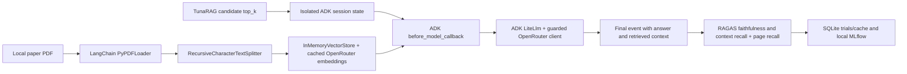

# Live Google ADK validation

This is a bounded integration campaign, not a claim that every ADK deployment or
every RAG answer is correct. It uses a real ADK `Agent` and `InMemoryRunner`, real
OpenRouter generation and embeddings, and real RAGAS model-based scoring. No
`EchoAgent`, fake model response, or handwritten RAG runtime is used in the paid
campaign. Separate credential-free tests deliberately inject provider responses.

## Pipeline and provider boundary



LangChain supplies PDF parsing, splitting, caching, and vector retrieval. ADK owns
agent orchestration and generation. A framework callback invokes the LangChain
retriever using `top_k` from session state, injects the retrieved excerpts into the
model request, and attaches context to final response metadata. This is application
wiring of framework components, not another custom agent implementation.

ADK's optional `LiteLlm` model uses its OpenAI-compatible route with the exact
`AsyncOpenAI` client already owned by the live fixture. Its base URL is HTTPS
OpenRouter; the extra `openai/` routing prefix is removed before sending the actual
model ID `openai/gpt-4.1-mini`. This client preserves the fixture's before-send
budget hook. SDK and LiteLLM retries are zero; output is bounded to 512 tokens.
`test_adk_transport.py` verifies the actual URL/model/output limit, token mapping,
single-attempt upstream failure, and budget rejection before transport execution.
Injected failures must surface as redacted `AdapterError` and delete ADK sessions.

This validates **Google ADK with OpenRouter**, not Google-native Gemini APIs,
Vertex AI authentication, streaming, model-directed tool calls, or ADK durable
checkpoints. Those require separate credentials, budgets, and campaigns.

## Coverage and acceptance

The source is the user-approved text-selectable *Attention Is All You Need* PDF.
The first three frozen development questions from `attention_questions.json` are
used for optimization. The first three held-out factual questions are reserved for
post-selection validation. These sets do not overlap. The broader LangChain and
LangGraph campaign uses more questions; this ADK add-on intentionally does not
repeat that entire benchmark.

| Check | Required evidence |
| --- | --- |
| Real parameter application | Two successful trials, `top_k=1` and `top_k=2`; exactly that many retrieved chunks for each sample. |
| Real evaluation | Both RAGAS metrics finite in `[0, 1]` for each trial and each held-out response. |
| Objective | Weighted faithfulness 0.4, context recall 0.4, page recall 0.2; exported winning candidate. |
| Usage | Provider-reported nonzero input/output tokens captured through ADK events. Dollar estimates are not presented as exact bills. |
| Persistence | SQLite study/trials, JSON and CSV reports, separately exported winning configuration. |
| Completed resume | Fresh optimizer reloads the same winner with zero new provider requests or retrieval callbacks. |
| Compatibility | Changed adapter revision rejects resume before provider execution. |
| Winner reuse | New ADK runners evaluate baseline and exported winner on three held-out questions each. |
| Session isolation | All runners have no remaining evaluation sessions after execution. |
| Tracking | Local MLflow run is FINISHED, has both trial metric steps, and no durable callback failure events. |

Quality improvement is reported from measured results, not required artificially
for a pass. A successful test means the integration and tuning lifecycle worked.
Three held-out questions are too few for statistical generalization claims.

## Run safely

Install optional test dependencies in a separate environment:

```powershell
python -m pip install -e ".[live-test,live-adk-test]"
python -m pytest tests/live/test_adk_transport.py --live
```

The transport tests require no API key and make no real model requests. CI runs
them with the real SDKs. Normal test runs skip live tests; paid CI remains disabled.

The paid test requires all three gates and explicit data/credential paths:

```powershell
python -m pytest tests/live/test_google_adk.py --live --live-paid --live-campaign --live-pdf="path/to/paper.pdf" --live-env="tests/live/.env" --live-request-limit=100 --basetemp=live-test-output/google-adk --junitxml=live-test-output/google-adk.xml
```

Use a new `--basetemp` for every attempt: pytest cleans an existing temporary
directory. Keep `.env`, raw provider logs, cached vectors, PDF data, and results
private. Never paste an API key into the command line or commit those files.

**A request limit is not a dollar limit.** Set an appropriate provider-side key
limit before running. For the authorized validation, the private execution wrapper
also reserves conservative costs before every send in the existing cumulative
ledger. It does not reset the earlier campaign spending or treat this as another
$5 allowance. Local MLflow traffic is not a model-provider request.

## Results and limitations

The 2026-10-09 live run passed: both trials succeeded and `top_k=2` won with
objective 0.688889 versus 0.666667 for `top_k=1`. Source regression: 165 passed,
21 opt-in skips. Clean-wheel regression: 157 passed, 22 skips (including the ADK
module absent from that minimal environment). The real-dependency suite passed
nine credential-free checks, including all three ADK transport cases.

| Held-out metric (three questions) | Baseline | Winner |
| --- | ---: | ---: |
| RAGAS faithfulness | 1.000000 | 1.000000 |
| RAGAS context recall | 0.666667 | 1.000000 |

Manual spot review found that the winner answers the previously unsupported
extrapolation question correctly. However, both positional-encoding answers
describe wavelengths without explicitly naming sine and cosine, as requested.
Faithfulness and context recall can both be 1 while an answer is incomplete:
context recall measures retrieval support, not answer completeness. A stricter
product-quality campaign needs an answer-correctness/completeness objective or
human review. Keep the frozen references unchanged rather than relaxing them.
The decoder-masking question also retrieves supporting page 5 instead of the
annotated page 3; its page-recall diagnostic is zero despite a supported answer.

The first attempt failed because the private response recorder assumed
`event_hooks` could not be `None`. Normalizing recorder initialization allowed
LiteLLM import; no package runtime code needed a fix. Both attempts remain in the
private cumulative budget ledger, and only the successful rerun is reported as
passed. The separately refreshed observed provider increase was $0.01978056,
bringing cumulative usage to $0.27617710, below the same approved $5 total.
These are observed key-usage figures, not a universal price or a new allowance.

Execution evidence belongs under `live-test-output/comprehensive/google-adk/` and
its adjacent JUnit file. The sanitized report records dependency versions, actual
provider usage delta, cumulative usage, trials, held-out metric means, and verified
boundaries. Do not substitute transport-test passes for live campaign passes.

Successful raw artifacts are in `google-adk-retry/`; the sanitized local report,
summary, and archive are `google-adk-results.md`, `google-adk-summary.json`, and
`google-adk-evidence.zip` under `live-test-output/comprehensive/`.

Real-model quality depends on retrieval, prompts, model versions, and judge
behavior. Small samples and a single PDF cannot establish universal improvement.
Interrupting a request may still incur provider charges even if no result was
persisted. Further ADK testing should cover native Google providers, multiple
candidate-controlled dimensions, LLMSearch, concurrent sessions, framework tools,
and hosted checkpoint services under separately reviewed budgets.
