# TunaRAG System Architecture

> V0.3 scope: TunaRAG tunes genuine LangChain runnables, compiled LangGraph graphs, and Google ADK 2.x runners through official adapters. Handwritten RAG adapters are unsupported. Evaluators, search strategies, and callbacks remain extensible.

## Context

TunaRAG runs in the user's Python process and controls optimization studies. The application framework
continues to own retrieval, generation, providers, corpus resources, and application semantics.



The following text outline provides a copyable alternative:

```text
Application or CLI
       |
   Optimizer ----> SearchStrategy
      |  |
      |  +-------> TrialRunner -> framework adapter -> user pipeline
      |                              |-------> LangChain runnable (optional)
      |                              |-------> compiled LangGraph
      |                              `-------> Google ADK Runner
      |                        -> Evaluators -> Objective
      +----------> ExperimentStore and Cache
      +----------> Events and callbacks -> optional MLflow
```

The system uses ports and adapters. Core orchestration depends on typed protocols, while
normalization, hashing, aggregation, and scoring remain deterministic and side-effect free.

## Control and data flow

Validate inputs; create or resume state; initialize or replay strategy observations; suggest,
validate, deduplicate, and reserve candidates; read cache or run bounded trials; evaluate and
aggregate; commit terminal state; notify observers; apply stop rules; return results.

SQLite is authoritative. MLflow is a post-commit mirror. Cache entries carry format and
semantic component versions plus checksums; corruption becomes a quarantined miss. Callbacks
execute outside transactions and scheduler locks.

## Invariants

- Strategies observe only committed terminal outcomes.
- Terminal trials never return to running.
- A semantic candidate occurs once per study.
- Resume requires compatible fingerprints or an explicit fork.
- Test-split outcomes do not guide search by default.
- Exact and estimated usage remain distinguishable.
- Trial failures are isolated unless study policy triggers.

The async entry point is authoritative. The sync wrapper owns a loop only when no loop is
active. Optional CLI and integrations call the public API rather than bypassing orchestration.

## Framework adapter boundary

`Optimizer` accepts only official framework adapter instances. `LangChainAdapter` and
`LangGraphAdapter` validate framework types and expose an async `ainvoke` boundary,
so TunaRAG maps one candidate and example into framework input/config, awaits execution, maps the
output, and returns usage through the shared trial runner. `GoogleADKAdapter` consumes runner
events in an isolated session and uses the same evaluation, retry, cache, and persistence path.

Candidate values default to the framework `configurable` namespace rather than graph state. This
keeps evaluation queries separate from tuning controls and works with reusable runnables. An
input mapper can instead merge parameters into state, while a factory can rebuild components
whose construction semantics cannot change through runtime configuration. Framework calls remain
outside SQLite transactions and inherit TunaRAG timeouts, retries, concurrency, caching, resume,
and trial failure isolation.
